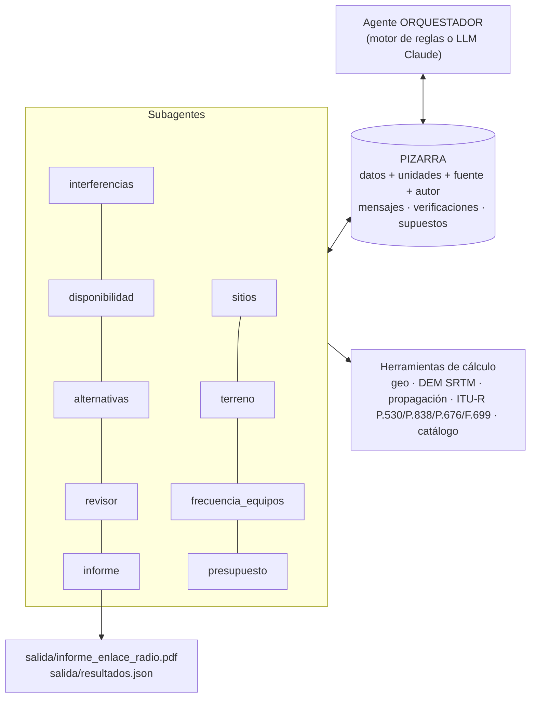

# Descripción del sistema multiagente

Entregable 2 de la práctica *Diseño y validación de un enlace de radio mediante agentes y subagentes de IA*.

## 1. Arquitectura

El sistema sigue el patrón **orquestador + subagentes especialistas + pizarra compartida** (*blackboard*).

* **Pizarra** (`agentes/base.py`): memoria común. Cada dato guarda valor, unidad, fuente y agente autor.
  También registra los **mensajes** entre agentes (solicitud, resultado, decisión, alerta), las
  **verificaciones** (OK/fallo, críticas o avisos) y los **supuestos**. Todo esto pasa al PDF (Anexo A y §10–11).
* **Herramientas** (`herramientas/`): funciones puras y deterministas. Los agentes no calculan "a ojo":
  siempre llaman a una herramienta.
* **Contexto** (`Contexto`): configuración del escenario, catálogo de equipos, acceso al DEM y rutas de salida.

## 2. Agentes y responsabilidades

| Agente | Responsabilidad | Herramientas | Verificaciones propias |
|---|---|---|---|
| **orquestador** | Planifica el flujo, delega, integra resultados, decide si el diseño cumple, pide alternativas, aplica el criterio de selección (mínimo costo que cumple), exige la revisión y ordena el informe | Todos los subagentes | Rechaza candidatos que no superan la revisión y prueba el siguiente |
| **sitios** | Valida los dos emplazamientos reales: coordenadas, elevación (SRTM), distancia y azimuts | `geo`, `dem.elevacion` | Elevación válida; distancia = 28 ± 2 km |
| **terreno** | Extrae el perfil real (934 muestras cada 30 m), añade curvatura y clutter, comprueba LOS y Fresnel, y busca las alturas mínimas de antena con los criterios de P.530 (1,0 F1 con k = 4/3 y 0,3 F1 con k = 2/3) | `dem.perfil`, `propagacion.analizar_despeje`, `alturas_minimas` | Perfil sin huecos; extremos coherentes con los sitios |
| **frecuencia_equipos** | Propone el diseño inicial: banda licenciada más alta que cubre la distancia, canal más estrecho que da la capacidad, polarización V y antenas de 0,6 m | `equipos.Catalogo` | Existe una modulación que da 200 Mbps |
| **presupuesto** | PIRE, FSPL (P.525), gases (P.676), Prx y margen para cada modulación ACM | `propagacion`, `equipos.modulaciones` | Margen > 0 en la modulación de referencia |
| **interferencias** | Escenarios cocanal con diagramas F.699 en ambas antenas; I/N, C/I y degradación del umbral; si un escenario no cumple, aplica el plan de frecuencias (polarización cruzada y luego canal adyacente) | `interferencia.*` | I/N ≤ −6 dB (F.758) |
| **disponibilidad** | Lluvia (P.838-3 + P.530-18 §2.4) y multitrayecto (P.530-18 §2.3.1) para la modulación que garantiza 200 Mbps; curva capacidad–disponibilidad ACM | `itur.*` | Indisponibilidad ≤ 0,01 % |
| **alternativas** | Genera variantes (banda × canal × antena × polarización) y calcula su costo relativo | `equipos.Catalogo` | — |
| **revisor** | Revisión técnica **independiente**: recalcula con fórmulas distintas (Friis con λ, ley de cosenos esférica, ganancia por área efectiva, despeje vectorial con el radio terrestre explícito), compara P.838-3 con las tablas publicadas, comprueba la suma del presupuesto, la inversión lluvia–margen, los requisitos, los límites de las estructuras y la coherencia de la decisión | Fórmulas propias | 22 comprobaciones; un fallo crítico obliga a cambiar de candidato |
| **informe** | Genera 9 figuras y compone el PDF (portada, índice, 12 secciones y 2 anexos) **solo a partir de la pizarra** | `graficas`, `pdf`, `redaccion` | — |

## 3. Flujo de trabajo

1. El orquestador publica el plan y los requisitos.
2. `sitios` valida los emplazamientos → `terreno` extrae el perfil.
3. `frecuencia_equipos` propone el diseño inicial **D0** (13 GHz, 28 MHz, V, 0,6 m).
4. Cadena de evaluación de D0: `terreno` (alturas) → `presupuesto` → `interferencias` → `disponibilidad`.
5. **D0 no cumple**: A0,01 = 51 dB frente a un margen de unos 12 dB (99,74 %). El orquestador lo deja registrado y pide alternativas.
6. `alternativas` genera 87 variantes; el orquestador las evalúa todas con la misma cadena (88 diseños, 9 cumplen).
7. El orquestador ordena las que cumplen por costo y envía la mejor al `revisor`. Si hay un fallo crítico, prueba la siguiente.
8. Diseño elegido: **A082, 7 GHz, 28 MHz, pol. V, antenas de 0,9 m, alturas de 21 m y 12 m, 512QAM = 200 Mbps,
   disponibilidad 99,9939 %**.
9. `informe` genera las figuras, `salida/informe_enlace_radio.pdf` y `salida/resultados.json`.

## 4. Motores de orquestación

| Motor | Cuándo | Qué decide el LLM |
|---|---|---|
| `reglas` (por defecto sin clave) | Reproducible y sin costo | Nada: el orquestador es un sistema experto determinista |
| `claude` (`--motor claude`, o `auto` con `ANTHROPIC_API_KEY`) | Orquestador LLM | Orden de las tareas, interpretación de resultados, qué variantes evaluar, elección y justificación, redacción del análisis del PDF |

En el modo `claude` (`src/enlace/llm.py`), el orquestador es un agente Claude (`claude-opus-5-5`, pensamiento
adaptativo, bucle manual de *tool use* con el SDK oficial `anthropic`). Cada subagente es una **herramienta**
con esquema estricto. Salvaguardas:

* **Las cifras solo salen de las herramientas.** Los textos que redacta Claude pasan por `verificar_cifras`:
  cada número citado debe coincidir (con la precisión con que se cita) con un resultado de la pizarra. Si no,
  la herramienta devuelve un error y Claude tiene que corregir. Tanto el rechazo como la aceptación quedan
  registrados en la tabla de verificaciones.
* `seleccionar_diseno` solo acepta diseños que cumplen **y** que superaron `revisar_diseno`.
* Si el LLM no termina el flujo (límite de iteraciones, rechazo, error), el motor de reglas lo completa y el
  PDF lo indica.
* Se activa el *fallback* del lado del servidor (`fallbacks="default"`) por si el modelo rechaza la solicitud.

## 5. Mecanismos de verificación

1. **Autoverificación** de cada subagente (sección 2).
2. **Revisión independiente** del agente revisor antes del informe.
3. **Verificación numérica** de la redacción del LLM (modo `claude`).
4. **Pruebas automáticas** (`tests/`): coeficientes P.838-3 frente a las tablas, escalado e inversión de lluvia,
   Friis, Fresnel, geodesia, diagrama F.699, flujo completo con reglas y flujo completo con un cliente Claude
   simulado (sin llamadas a la API).
5. **Trazabilidad**: cada resultado del PDF tiene autor, fuente y supuestos; el Anexo A muestra todos los mensajes.

## 6. Datos y supuestos principales

* Sitios: A (Bogotá, 4,6860° N, 74,0480° W, 2 562 m) y B (zona rural entre Cajicá y Zipaquirá, 4,9378° N,
  74,0480° W, 2 646 m). El emplazamiento B se eligió con un barrido de rumbos sobre el DEM: es el que da el
  mejor despeje a 28 km de la central.
* DEM: SRTM 1" (AWS Terrain Tiles). Si no hay red se usa `data/perfil_terreno.csv`.
* Clima: R0,01 = 95 mm/h (P.837-1, zona N, valor conservador) y dN1 = −250.
* Clutter: 15 m en zona urbana (0–9,5 km) y 10 m en zona rural.
* Equipos: perfiles típicos de la industria (`data/equipos.json`). Hay que sustituirlos por la hoja de datos del modelo que se compre.
* Interferencias: escenarios hipotéticos (no hay acceso a la base de asignaciones de la ANE).
